# 💼 Boleta de Pago – SwiftUI

Aplicación desarrollada en **SwiftUI** que permite calcular el sueldo neto de un trabajador, considerando sus remuneraciones, horas extras y descuentos por ONP o AFP.

##  Funcionalidades

- Registro de datos del trabajador.
- Cálculo de sueldo y horas extras.
- Selección del sistema de pensiones ONP o AFP.
- Cálculo de descuentos y sueldo neto.
- Validación de datos ingresados.
- Generación de boleta de pago en PDF.

##  Capturas de la aplicación

### Formulario de datos
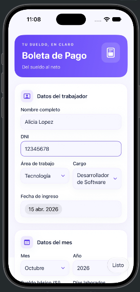

### Sistema de pensiones
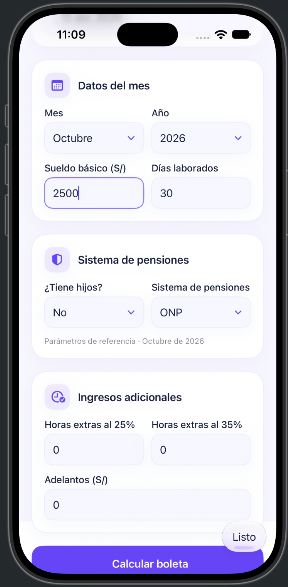

### Boleta generada
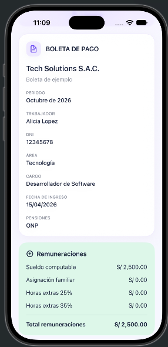

##  Casos de prueba

Se realizaron cuatro casos para comprobar el funcionamiento y los cálculos de la aplicación.

### Caso 1
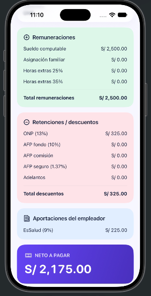

### Caso 2
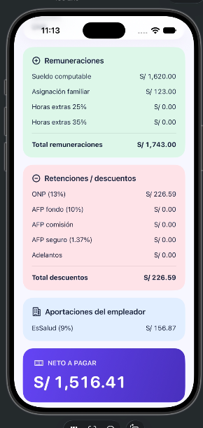

### Caso 3
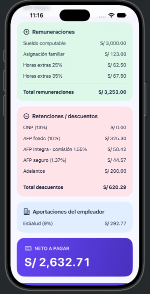

### Caso 4
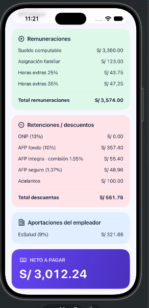

##  Caso real: Oferta laboral

Se tomó como referencia una oferta laboral de la empresa **VIALE**, para el puesto de **Analista de Sistemas y Base de Datos**, con un sueldo mensual de **S/ 2,500**.

**Fuente:** [Oferta laboral de VIALE](https://portallaboral.cibertec.edu.pe/trabajar-en-viale1/trabajos/analista-de-sistemas-y-base-de-datos-rubro-retail/962680)

**Fecha de consulta:** 29/10/2026

### Oferta laboral
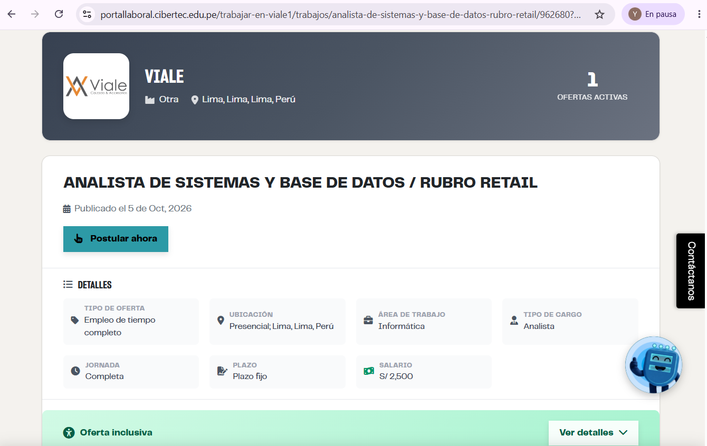

### Formulario del trabajador
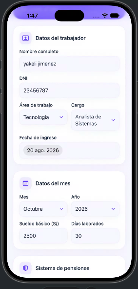

### Boleta generada
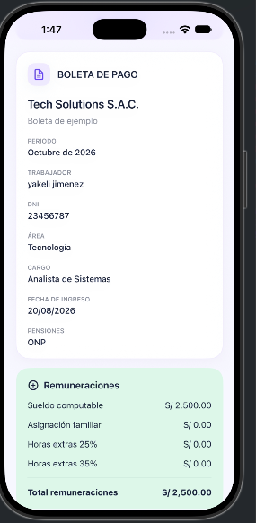

### Resultado final
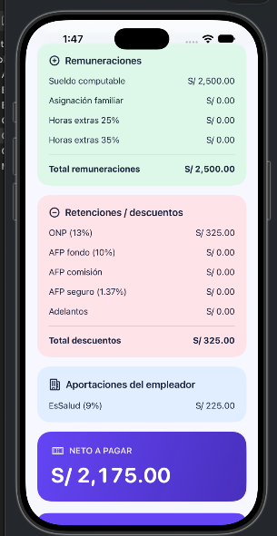

### Boleta exportada en PDF
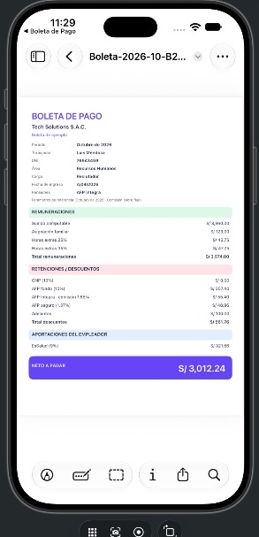

---

**Curso:** Programación en Móviles Avanzado  
